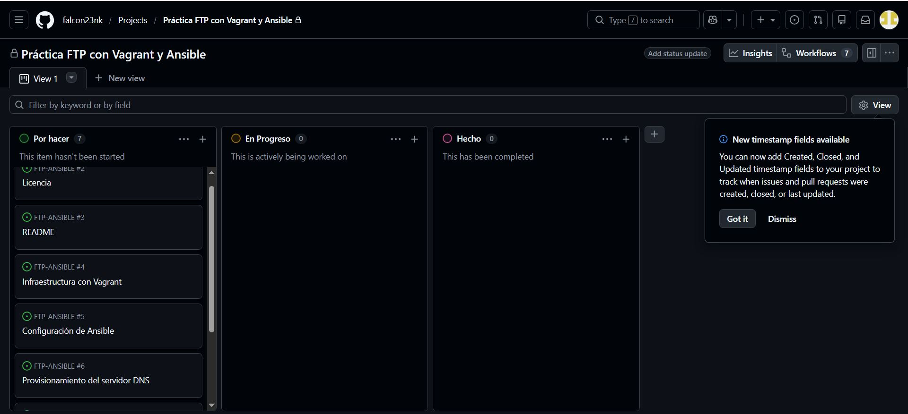
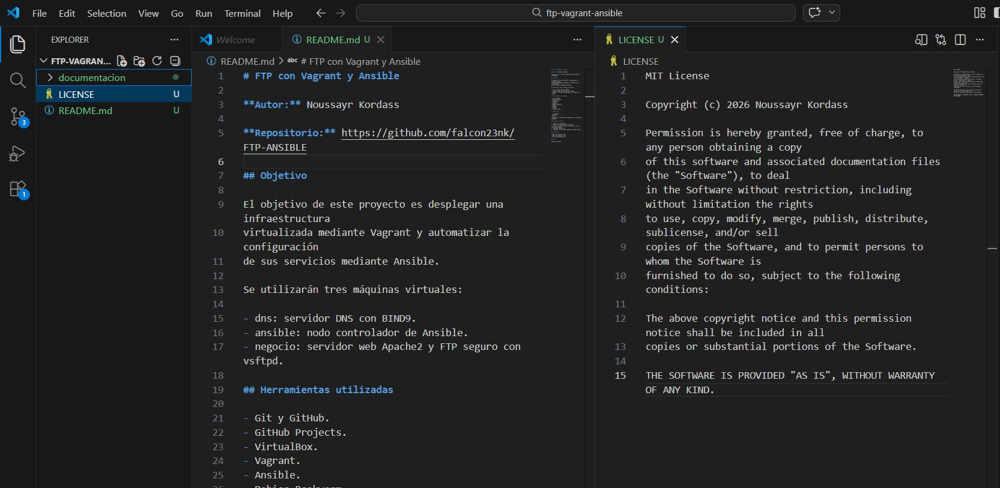
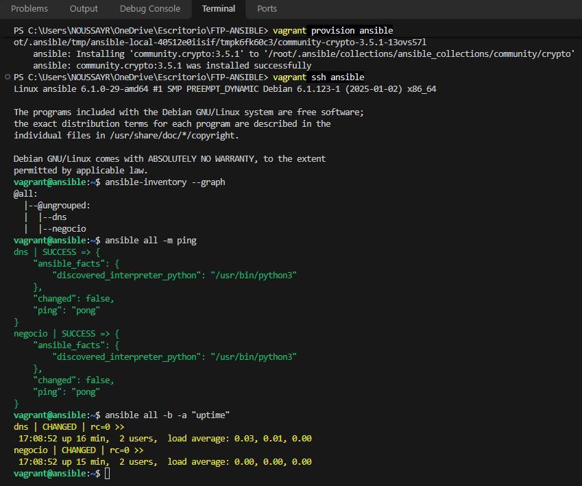
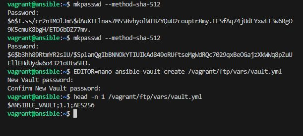
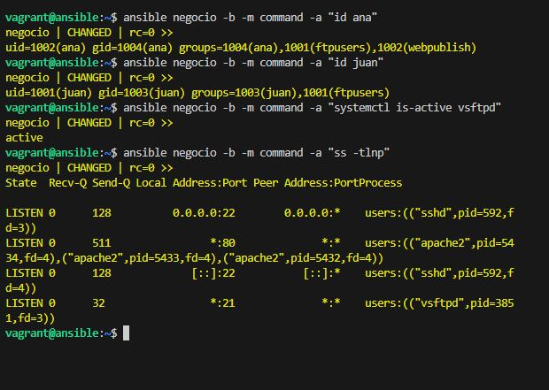
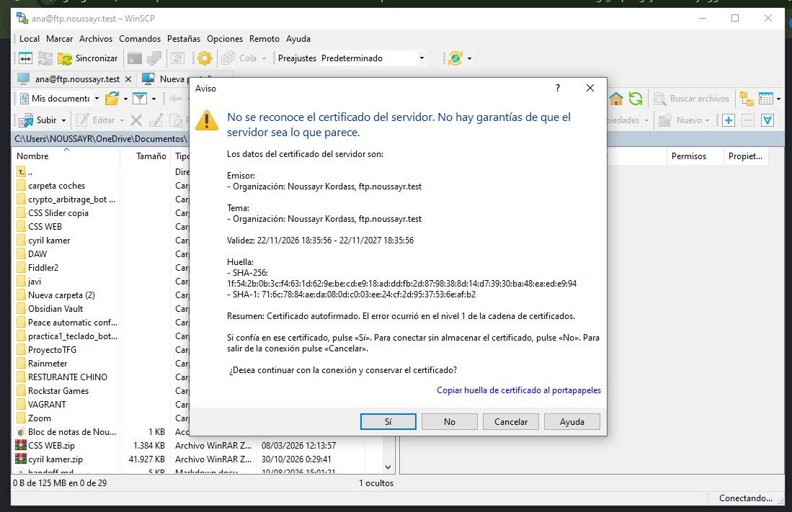
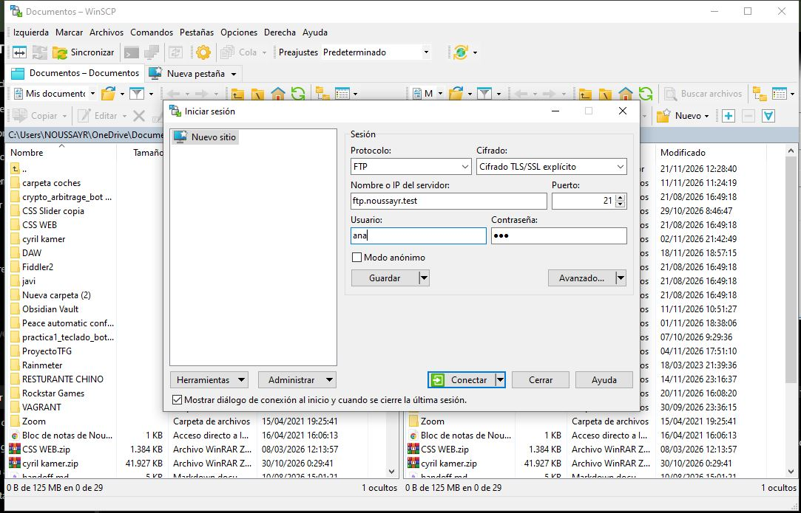

# Capturas del proyecto

Este documento recoge las capturas realizadas durante la puesta en marcha y la comprobación del proyecto.

## Gestión del proyecto

### Proyectos e incidencias

### Licencia y README

## Infraestructura con Vagrant

### Configuración de las tres máquinas

### Script de instalación y dependencias

### Máquinas virtuales funcionando

## Configuración de Ansible

### Conexión entre las máquinas

### Archivos y configuración DNS

### Ejecución del playbook DNS y pruebas

## Servicio web

### Playbook y página HTML

### Página web mediante el nombre DNS

## Servicio FTP

### Configuración de vsftpd

### Protección de variables con Ansible Vault

### Playbook FTP y comprobación de sintaxis

### Servicio FTP funcionando

### Ubicación configurada para el usuario ana

### Configuración de FTP

### Configuración de usuarios en WinSCP

## Actualizaciones y comprobaciones

### Archivo actualizado correctamente

### Página web actualizada

### Ruta e intento de acceso restringido

## Git y clonado del proyecto

### Máquinas y servicios después de clonar el proyecto

### Conversión de formatos de línea

### Proyecto clonado y comprobación de funcionamiento

